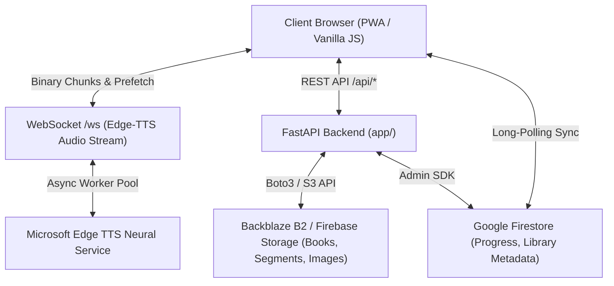

# Cloud TTS Reader Pro

<p align="center">
  
</p>

<p align="center">
  <strong>An advanced, high-performance web audio reader powered by Microsoft Edge TTS, FastAPI, and Firebase.</strong>
</p>

<p align="center">
  <a href="https://github.com/sunbv56/Cloud_TTS_Reader/actions/workflows/ci.yml"></a>
  
  
  
  
  
</p>

<p align="center">
  🌐 <strong>Language:</strong> <a href="README.md">English</a> | <a href="README.vi.md">Tiếng Việt (Vietnamese)</a>
</p>

---

## 🌟 Key Highlights

- ⚡ **Gapless Audio Streaming**: Real-time sentence-by-sentence synthesis using Microsoft Edge TTS streamed through WebSockets directly into browser MediaSource (MSE).
- 🚀 **Super-Charged 50-Worker Offline MP3 Export**: Ultra-fast offline chapter generation utilizing a sliding-window concurrency pipeline with up to 50 parallel workers.
- 📚 **Multi-Format Book Support**: Parses large TXT (UTF-8, UTF-16, UTF-8-BOM, Windows-1258), EPUB, and text-based PDF documents.
- 🧩 **Segmented Chapter Architecture**: Massive books (200+ to 1,000+ chapters) are partitioned into 50-chapter lightweight segments for instant page navigation and near-zero memory footprint.
- 🛡️ **AdBlock & Brave Shields Proof**: Firestore synchronization operates over HTTP Long Polling (`experimentalForceLongPolling`), bypassing client-side tracker/streaming filters.
- 🎨 **UI/UX Pro Max Aesthetics**: Glassmorphism dark mode, theme customizer, floating mini player widget, and fluid GSAP micro-animations.
- 🔄 **Cross-Device Progress Sync**: Automatically synchronizes reading progress, bookmarks, and custom voice parameters via Firebase Firestore.
- 📱 **Progressive Web App (PWA)**: Installable on Android, iOS, Windows, and macOS with offline support.

---

## 🏗️ Architecture Overview



---

## 📁 Repository Structure

```
Cloud_TTS_Reader/
├── app/                        # Modular Backend Package
│   ├── core/                   # Configuration, Database, Memory & Security
│   │   ├── config.py           # Resource quotas, worker counts & limits
│   │   ├── database.py         # Firebase Admin & Storage adapter connectors
│   │   ├── memory.py           # Garbage collection & malloc_trim helpers
│   │   └── security.py         # Bearer token validation & payload sanitizers
│   ├── parsers/                # Document Parsers
│   │   ├── base.py             # Segmentation, chapter models & encodings
│   │   ├── epub_parser.py      # EPUB item extraction
│   │   ├── pdf_parser.py       # PDF text extractor
│   │   └── txt_parser.py       # TXT regex delimiter parser
│   ├── routers/                # FastAPI Route Controllers
│   │   ├── books.py            # Story CRUD, chapter ops, segment loading
│   │   ├── system.py           # Health ping & Firebase config delivery
│   │   ├── tts.py              # REST TTS streaming & download endpoints
│   │   └── ws_tts.py           # WebSocket real-time TTS audio pipeline
│   └── services/               # Core Business Logic
│       ├── book_service.py     # 50-chapter segment persistence & migrations
│       ├── cache_service.py    # Threadpool executor & LRU legacy source caching
│       └── tts_service.py      # TTS chunk bounded generators & download schemas
├── main.py                     # Backward-compatible facade & entrypoint
├── storage_adapter.py          # Unified B2 / S3 / Firebase Storage adapter
├── static/                     # Modern Vanilla Frontend
│   ├── css/                    # Style sheets (console design system, mini-player)
│   ├── js/                     # Frontend ES Modules (UI interactions, i18n, stats)
│   ├── app.js                  # Frontend Application Master Controller
│   ├── index.html              # Reader SPA HTML5 Entrypoint
│   ├── manifest.json           # PWA Manifest
│   └── sw.js                   # Service Worker Cache
├── tests/                      # Automated Test Suite (Pytest)
│   ├── conftest.py             # Pytest root path resolution
│   ├── test_parsers.py         # Encoding & parser tests
│   ├── test_routers.py         # REST & WebSocket endpoint tests
│   ├── test_storage_adapter.py # B2 resilient download tests
│   └── test_tts_service.py     # TTS schema & chunk size tests
└── .github/workflows/ci.yml    # GitHub Actions Continuous Integration
```

---

## 🚀 Getting Started

### 1. Prerequisites
- **Python 3.10+**
- **pip** and **virtualenv**
- (Optional) **Firebase Account** & **Backblaze B2 Bucket** for cloud synchronization.

### 2. Installation

1. **Clone the repository**:
   ```bash
   git clone https://github.com/sunbv56/Cloud_TTS_Reader.git
   cd Cloud_TTS_Reader
   ```

2. **Create and activate a virtual environment**:
   ```bash
   # Linux / macOS
   python3 -m venv venv
   source venv/bin/activate

   # Windows (PowerShell)
   python -m venv venv
   .\venv\Scripts\Activate.ps1
   ```

3. **Install dependencies**:
   ```bash
   pip install -r requirements.txt
   ```

4. **Configure Environment Variables**:
   Copy `.env.example` to `.env` and configure your credentials:
   ```bash
   cp .env.example .env
   ```

   Key configuration parameters:
   ```ini
   # Storage Backend ('firebase' or 'b2')
   STORAGE_BACKEND=b2
   B2_ENDPOINT_URL=https://s3.us-east-005.backblazeb2.com
   B2_BUCKET_NAME=your-bucket-name
   B2_KEY_ID=your-b2-key-id
   B2_APPLICATION_KEY=your-b2-app-key

   # High-Concurrency Workers (up to 50 for offline generation)
   MAX_WS_WORKERS=50
   MAX_WS_QUEUE=100

   # Firebase Service Account JSON (Single-line string)
   FIREBASE_SERVICE_ACCOUNT={"type": "service_account", ...}
   FIREBASE_STORAGE_BUCKET=your-app.appspot.com
   ```

5. **Start the Application**:
   ```bash
   python main.py
   ```
   Open your browser and navigate to: **`http://localhost:8008`**.

---

## 🧪 Running Tests

The test suite runs with `pytest` covering 100% of core components:

```bash
# Run all unit and integration tests
python -m pytest tests/ -v
```

---

## 🎧 Usage Guide

### Real-Time Streaming Mode
1. Click **Import Book** or select an existing title from your **Library**.
2. Select your desired voice (e.g. `vi-VN-HoaiMyNeural` or `vi-VN-NamMinhNeural`), adjust reading speed, pitch, and volume.
3. Click **Play** $\rightarrow$ Audio will stream continuously with real-time sentence highlighting and zero gaps between sentences.

### Super-Charged 50-Worker Offline MP3 Export
1. Open the **Table of Contents (TOC)** sidebar.
2. Select between **1 to 5 chapters** using the checkboxes.
3. Click **Download Offline MP3** $\rightarrow$ The app automatically activates the 50-worker pipeline, downloading chunks in parallel and merging them into an offline MP3 audio file.

---

## 🤝 Contributing

Contributions, issues, and feature requests are welcome!
1. Fork the Project.
2. Create your Feature Branch (`git checkout -b feature/AmazingFeature`).
3. Commit your Changes (`git commit -m 'feat: add some amazing feature'`).
4. Push to the Branch (`git push origin feature/AmazingFeature`).
5. Open a Pull Request.

---

## ⚠️ Disclaimer & Credits

- This is a personal, educational project. It is **not affiliated with, endorsed by or sponsored by Microsoft or Google**.
- Speech is synthesized through Microsoft Edge's online read-aloud service, reached with the unofficial [`edge-tts`](https://github.com/rany2/edge-tts) library. Microsoft has not published a public API or terms for this use, and the service can change or block access at any time. You are responsible for complying with Microsoft's terms. Do not use this project to run a commercial service or to redistribute the generated audio.
- The optional proxy (`EDGE_TTS_PROXY`) and the gTTS fallback exist only to keep reading going when a direct request stalls. They are not meant to evade limits; use the service responsibly.
- Books you import must be content you have the right to use.
- Third-party libraries keep their own licenses: `edge-tts` is LGPL-3.0 (installed unmodified as a dependency and not bundled in this repository), `gTTS` is MIT, and the rest are listed in `requirements.txt`.

---

## 📄 License

This project is licensed under the **MIT License** - see the [LICENSE](LICENSE) file for details.
