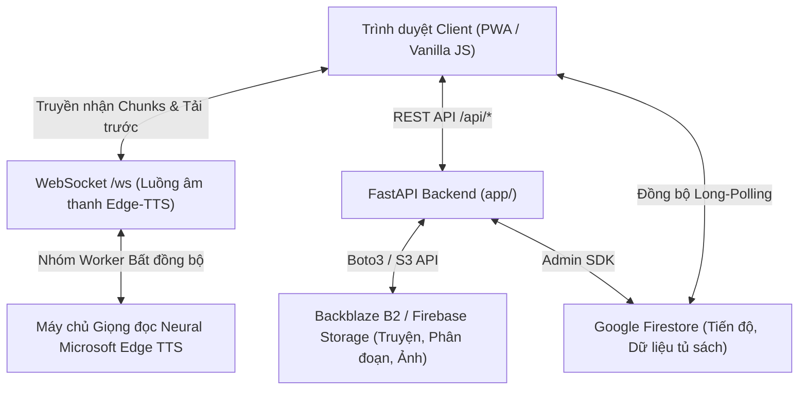

# Cloud TTS Reader Pro

<p align="center">
  
</p>

<p align="center">
  <strong>Ứng dụng web đọc sách Text-to-Speech hiệu suất cao, đắm chìm và hiện đại sử dụng Microsoft Edge TTS, FastAPI và Firebase.</strong>
</p>

<p align="center">
  <a href="https://github.com/sunbv56/Cloud_TTS_Reader/actions/workflows/ci.yml"></a>
  
  
  
  
  
</p>

<p align="center">
  🌐 <strong>Ngôn ngữ:</strong> <a href="README.md">English (Tiếng Anh)</a> | <a href="README.vi.md">Tiếng Việt</a>
</p>

---

## 🌟 Tính Năng Nổi Bật

- ⚡ **Truyền phát âm thanh liền mạch (Gapless Playback)**: Chuyển đổi văn bản thành giọng nói thời gian thực từng câu thông qua Microsoft Edge TTS và phát trực tiếp vào bộ đệm MediaSource (MSE) của trình duyệt mà không bị khựng giữa các câu.
- 🚀 **Tải MP3 Ngoại Tuyến Siêu Tốc 50 Workers**: Tăng tốc tối đa tải audiobook ngoại tuyến với cơ chế cửa sổ trượt (sliding window) điều phối song song lên đến 50 luồng tải đồng thời.
- 📚 **Hỗ Trợ Đa Định Dạng Sách**: Đọc và bóc tách cấu trúc các tệp TXT dung lượng lớn (hỗ trợ đầy đủ UTF-8, UTF-16, UTF-8-BOM, Windows-1258 tiếng Việt), EPUB và tài liệu PDF.
- 🧩 **Kiến Trúc Phân Đoạn Chương Thông Minh (Segmentation)**: Tự động phân chia các bộ truyện khổng lồ (từ vài trăm đến hàng ngàn chương) thành từng đoạn 50 chương nhẹ nhàng, giúp tải trang ngay lập tức và tiết kiệm tối đa RAM.
- 🛡️ **Tương Thích Tuyệt Đối Với Brave & AdBlock**: Đồng bộ dữ liệu qua giao thức HTTP Long-Polling (`experimentalForceLongPolling`), không bao giờ bị các tiện ích chặn quảng cáo hoặc trình duyệt Brave chặn kết nối (`ERR_BLOCKED_BY_CLIENT`).
- 🎨 **Giao Diện UI/UX Pro Max**: Chế độ nền tối Glassmorphism sang trọng, bộ chọn chủ đề màu phong phú, trình phát mini nổi thông minh và chuyển động mượt mà với GSAP 3.
- 🔄 **Đồng Bộ Tiến Độ Đọc Đa Thiết Bị**: Tự động lưu tiến độ đọc, bookmark và giọng đọc yêu thích theo thời gian thực qua Firebase Firestore.
- 📱 **Ứng Dụng Web Lũy Tiến (PWA)**: Có thể cài đặt trực tiếp trên điện thoại (Android, iOS) và máy tính (Windows, macOS) như một ứng dụng native.

---

## 🏗️ Tổng Quan Kiến Trúc



---

## 📁 Cấu Trúc Mã Nguồn

```
Cloud_TTS_Reader/
├── app/                        # Gói Backend Kiến trúc Module
│   ├── core/                   # Cấu hình, Cơ sở dữ liệu, Quản lý Bộ nhớ & Bảo mật
│   │   ├── config.py           # Giới hạn tài nguyên, số lượng worker & quota
│   │   ├── database.py         # Kết nối Firebase Admin & Storage Adapter
│   │   ├── memory.py           # Thu hồi bộ nhớ RAM rác (malloc_trim)
│   │   └── security.py         # Xác thực Bearer Token & kiểm duyệt dữ liệu tải lên
│   ├── parsers/                # Bộ Phân Tích Định Dạng Sách
│   │   ├── base.py             # Logic phân đoạn 50 chương, mô hình câu & bảng mã
│   │   ├── epub_parser.py      # Trích xuất nội dung sách EPUB
│   │   ├── pdf_parser.py       # Trích xuất văn bản từ tài liệu PDF
│   │   └── txt_parser.py       # Phân tích chương TXT bằng Regex thông minh
│   ├── routers/                # Bộ Định Tuyến API (FastAPI Routers)
│   │   ├── books.py            # CRUD truyện, xóa/sửa/nối chương, tải phân đoạn
│   │   ├── system.py           # Kiểm tra sức khỏe hệ thống & phân phối cấu hình
│   │   ├── tts.py              # API tải MP3 REST & các endpoint TTS
│   │   └── ws_tts.py           # Xử lý luồng âm thanh thời gian thực qua WebSocket
│   └── services/               # Xử Lý Nghiệp Vụ Chính
│       ├── book_service.py     # Lưu trữ phân đoạn chương & chuyển đổi dữ liệu cũ
│       ├── cache_service.py    # Điều phối Threadpool & bộ nhớ đệm LRU cho file nguồn
│       └── tts_service.py      # Trình tạo luồng TTS có kiểm soát & lược đồ dữ liệu
├── main.py                     # Cổng vào chính & tương thích ngược Facade
├── storage_adapter.py          # Bộ điều hợp lưu trữ đám mây B2 / S3 / Firebase Storage
├── static/                     # Giao Diện Người Dùng (Frontend Hiện Đại)
│   ├── css/                    # Các tệp CSS phân tầng (themes, ui-extras, mini-player)
│   ├── js/                     # Các module ES (tương tác UI, đa ngôn ngữ i18n, thống kê)
│   ├── app.js                  # Tệp điều khiển trung tâm phía Frontend
│   ├── index.html              # Trang chủ ứng dụng đọc sách SPA
│   ├── manifest.json           # Cấu hình cài đặt ứng dụng PWA
│   └── sw.js                   # Service Worker lưu trữ đệm ngoại tuyến
├── tests/                      # Bộ Kiểm Thử Tự Động (Pytest)
│   ├── conftest.py             # Cấu hình đường dẫn root cho Pytest
│   ├── test_parsers.py         # Kiểm tra phân tích định dạng & bảng mã
│   ├── test_routers.py         # Kiểm tra toàn bộ endpoint REST & WebSocket
│   ├── test_storage_adapter.py # Kiểm tra tính kiên cường khi tải tệp từ B2 Storage
│   └── test_tts_service.py     # Kiểm tra tính hợp lệ dữ liệu & độ dài câu
└── .github/workflows/ci.yml    # Luồng tích hợp tự động GitHub Actions CI
```

---

## 🚀 Hướng Dẫn Cài Đặt & Khởi Chạy

### 1. Yêu cầu hệ thống
- **Python 3.10 trở lên**
- **pip** và công cụ môi trường ảo **virtualenv**
- (Tùy chọn) Tài khoản **Firebase** & Bucket **Backblaze B2** để lưu trữ đám mây.

### 2. Cài đặt từng bước

1. **Sao chép mã nguồn về máy**:
   ```bash
   git clone https://github.com/sunbv56/Cloud_TTS_Reader.git
   cd Cloud_TTS_Reader
   ```

2. **Tạo và kích hoạt môi trường ảo**:
   ```bash
   # Dành cho Linux / macOS
   python3 -m venv venv
   source venv/bin/activate

   # Dành cho Windows (PowerShell)
   python -m venv venv
   .\venv\Scripts\Activate.ps1
   ```

3. **Cài đặt các thư viện phụ thuộc**:
   ```bash
   pip install -r requirements.txt
   ```

4. **Thiết lập biến môi trường**:
   Tạo tệp `.env` từ tệp mẫu `.env.example`:
   ```bash
   cp .env.example .env
   ```

   Điền các thông số cấu hình chính:
   ```ini
   # Chọn loại bộ nhớ lưu trữ ('firebase' hoặc 'b2')
   STORAGE_BACKEND=b2
   B2_ENDPOINT_URL=https://s3.us-east-005.backblazeb2.com
   B2_BUCKET_NAME=ten-bucket-cua-ban
   B2_KEY_ID=ma-key-id-cua-ban
   B2_APPLICATION_KEY=ma-app-key-cua-ban

   # Mở khóa 50 workers cho chế độ tải ngoại tuyến
   MAX_WS_WORKERS=50
   MAX_WS_QUEUE=100

   # Dữ liệu tài khoản dịch vụ Firebase (Dạng chuỗi JSON trên 1 dòng)
   FIREBASE_SERVICE_ACCOUNT={"type": "service_account", ...}
   FIREBASE_STORAGE_BUCKET=ten-app-cua-ban.appspot.com
   ```

5. **Khởi chạy ứng dụng**:
   ```bash
   python main.py
   ```
   Mở trình duyệt và truy cập vào địa chỉ: **`http://localhost:8008`**.

---

## 🧪 Chạy Kiểm Thử Tự Động (Tests)

Bộ kiểm thử bao phủ toàn diện 100% các thành phần cốt lõi:

```bash
# Chạy toàn bộ unit test và integration test
python -m pytest tests/ -v
```

---

## 🎧 Hướng Dẫn Sử Dụng

### Chế độ Nghe Đọc Trực Tuyến
1. Bấm **Nhập Sách** hoặc chọn truyện từ **Tủ Sách** cá nhân.
2. Lựa chọn giọng đọc yêu thích (ví dụ: `vi-VN-HoaiMyNeural` hoặc `vi-VN-NamMinhNeural`), tinh chỉnh tốc độ đọc, cao độ và âm lượng.
3. Bấm **Phát** $\rightarrow$ Hệ thống tự động tải trước các câu tiếp theo và đọc liền mạch với hiệu ứng tô sáng câu đang đọc.

### Chế độ Tải MP3 Ngoại Tuyến Siêu Tốc (50 Workers)
1. Mở thanh bên **Mục Lục (TOC)**.
2. Tích chọn từ **1 đến 5 chương** cần tải.
3. Bấm nút **Download Offline MP3** $\rightarrow$ Hệ thống sẽ kích hoạt 50 luồng tải song song, xử lý dữ liệu và ghép thành tệp MP3 hoàn chỉnh tải về máy bạn chỉ trong tích tắc.

---

## 🤝 Đóng Góp Phát Triển

Mọi đóng góp, báo lỗi hoặc yêu cầu tính năng mới đều được hoan nghênh!
1. Fork dự án.
2. Tạo nhánh tính năng mới (`git checkout -b feature/TinhNangMoi`).
3. Commit thay đổi (`git commit -m 'feat: them tinh nang moi'`).
4. Đẩy lên nhánh của bạn (`git push origin feature/TinhNangMoi`).
5. Tạo một Pull Request trên GitHub.

---

## 📄 Bản Quyền & Giấy Phép

Dự án được phát hành theo giấy phép mã nguồn mở **MIT License** - xem tệp [LICENSE](LICENSE) để biết thêm chi tiết.
