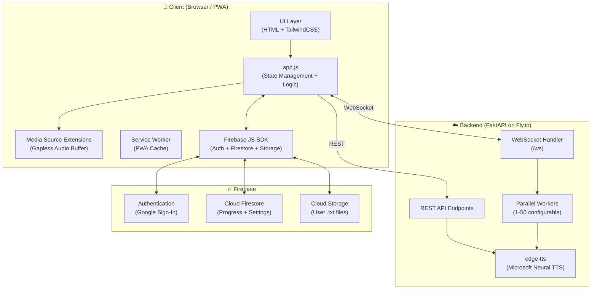
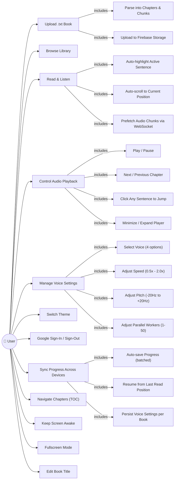
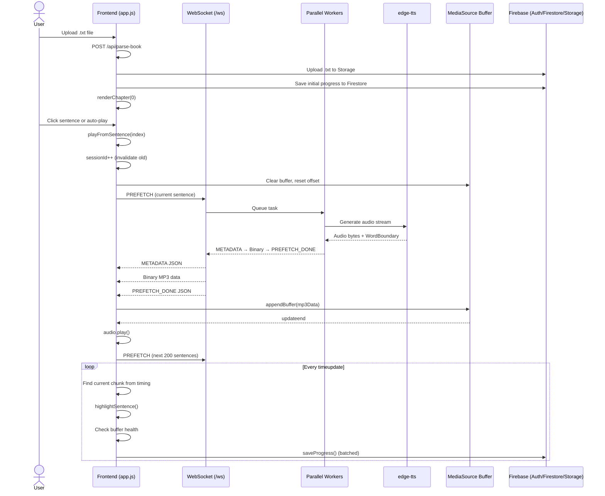
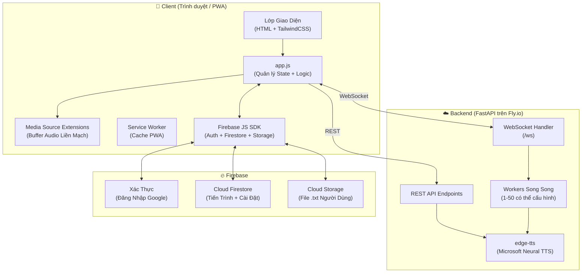
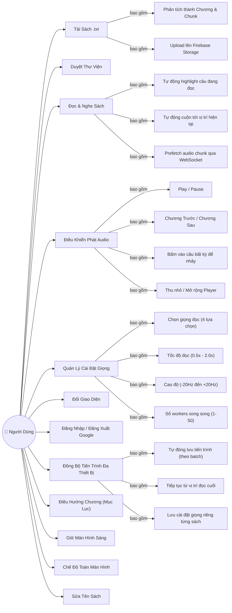
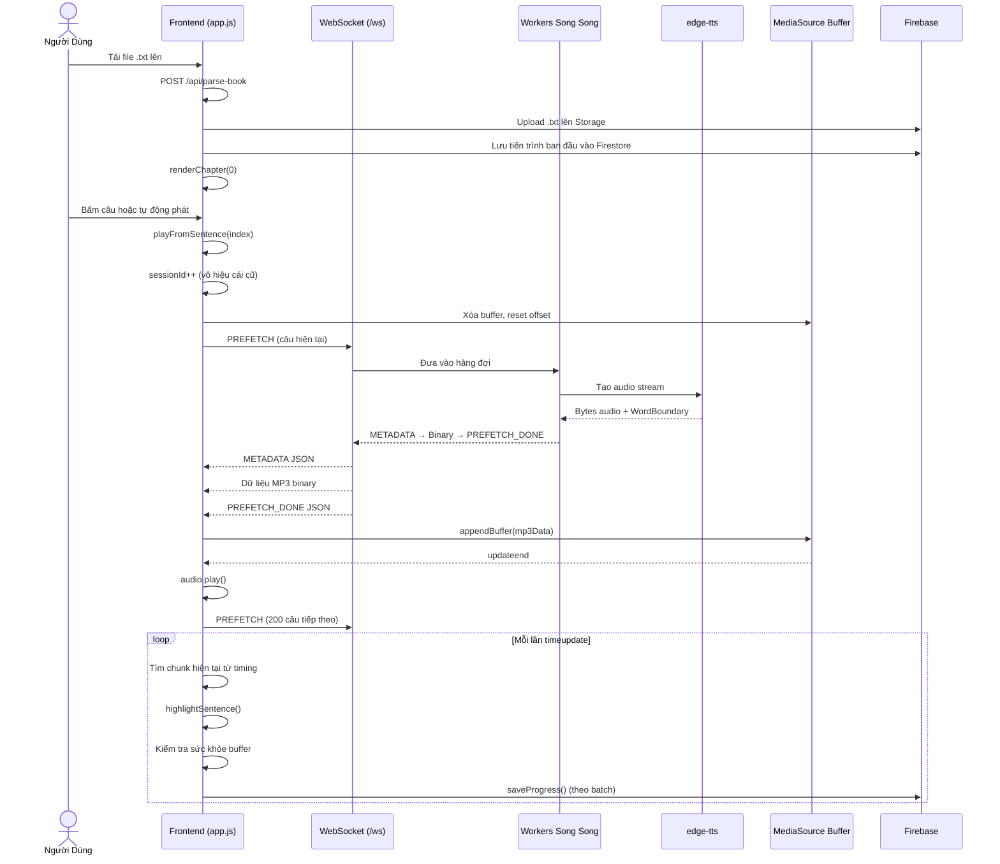

# Cloud TTS Reader — Project Summary & Context for Mobile App Development

---

## ENGLISH SECTION

---

### 1. Project Overview

**Cloud TTS Reader** is a cloud-based Text-to-Speech e-book reader web application. Users upload `.txt` files, which are automatically parsed into chapters and sentences (chunks). The app uses **Microsoft Edge TTS (edge-tts)** to convert text to speech in real-time via streaming, enabling a seamless audiobook listening experience with synchronized text highlighting.

The app features two deployment modes:
- **`main.py` (FastAPI + WebSocket)** — The primary production version deployed on **Fly.io** as a Docker container. Uses WebSocket for real-time parallel audio generation with multi-worker architecture.
- **`kaggle.py` (Gradio)** — A legacy/alternative version designed to run on Kaggle Notebooks with a Gradio UI. Uses sequential fetch-based audio generation.

> **For the mobile app, focus exclusively on the `main.py` architecture.**

---

### 2. Technology Stack

| Layer | Technology |
|---|---|
| **Backend** | Python 3.10, FastAPI, Uvicorn |
| **TTS Engine** | `edge-tts` (Microsoft Edge Neural TTS, free, no API key needed) |
| **Frontend** | HTML, JavaScript (ES Modules), TailwindCSS v4 (browser CDN) |
| **Authentication** | Firebase Authentication (Google Sign-In) |
| **Database** | Cloud Firestore (progress sync, settings, book metadata) |
| **File Storage** | Firebase Storage (user-uploaded `.txt` files) |
| **Deployment** | Docker → Fly.io (256MB RAM, shared CPU) |
| **PWA** | Service Worker + Web App Manifest (installable on mobile) |
| **Real-time Comm** | WebSocket (multi-worker parallel audio streaming) |
| **Audio Playback** | Media Source Extensions (MSE) for gapless streaming |

---

### 3. Architecture Diagram



---

### 4. Core Features & Use Cases



---

### 5. Feature Details

#### 5.1 Book Upload & Parsing
- User uploads `.txt` file via file picker
- Backend endpoint `POST /api/parse-book` receives file
- **Chapter parsing**: Split text by `===` (3+ equal signs) as chapter delimiter
- **Chunk splitting**: Each chapter is further split into sentences/chunks (max 800 chars each)
  - Split by newlines first, then by sentence boundaries `[.!?]`
  - Only keep chunks containing alphanumeric characters
- Simultaneously uploads raw `.txt` to Firebase Storage for cross-device access

#### 5.2 Audio Generation (TTS)
- Uses `edge-tts` library (free Microsoft Neural TTS voices)
- **Available voices**:
  - `vi-VN-HoaiMyNeural` — Vietnamese Female (default)
  - `vi-VN-NamMinhNeural` — Vietnamese Male
  - `en-US-AriaNeural` — English Female
  - `en-US-GuyNeural` — English Male
- Configurable parameters: `rate` (speed), `pitch`, `volume`
- Audio output format: MP3 (audio/mpeg)
- Also returns `WordBoundary` metadata (word-level timing offsets)

#### 5.3 WebSocket Multi-Worker System
- Single WebSocket connection per client at `/ws`
- Client sends `PREFETCH` messages with text, voice settings, and a `sessionId`
- Server maintains an `asyncio.Queue` and spawns N parallel worker tasks
- Each worker:
  1. Picks a task from queue
  2. Checks if task's `sessionId` is still active (skip if stale)
  3. Generates audio via `edge-tts`
  4. Mid-stream abort if new session detected
  5. Sends back: `METADATA` (JSON) → Binary audio data → `PREFETCH_DONE` (JSON)
- On new session: purge queue, kill all workers, respawn fresh workers
- Heartbeat: client sends `PING` every 30s, server responds with `PONG`

#### 5.4 MSE (Media Source Extensions) Gapless Playback
- Client uses `MediaSource` API to create a seamless audio stream
- Each MP3 chunk is appended to a `SourceBuffer` with calculated `timestampOffset`
- **Gap elimination**: Uses word boundary metadata to calculate exact speech end time and overlap chunks by ~0.1s
- **Ordered append**: Chunks are sorted by `(chapterIndex, index)` and appended strictly in order (out-of-order chunks wait in queue)
- **Buffer cleanup**: Automatically removes played audio (> 300s old, keeps last 10s) to prevent memory issues
- **Stall recovery**: Detects buffer underrun and triggers emergency prefetch

#### 5.5 Progress Sync (Firebase)
- **Batched saves**: Only syncs to Firestore when chunk distance ≥ 10 from last save, or on forced save events
- **Force save triggers**: Pause, book switch, page unload, manual sync
- **Data model** (Firestore path: `users/{uid}/progress/{bookId}`):
  ```json
  {
    "title": "Book Title",
    "filename": "original_file.txt",
    "last_read_chunk": 42,
    "total_chunks": 500,
    "settings": {
      "voice": "vi-VN-HoaiMyNeural",
      "speed": 1.0,
      "pitch": "+0Hz",
      "volume": "+0%",
      "numWorkers": 5
    },
    "updated_at": "<server_timestamp>"
  }
  ```

#### 5.6 Theme System
- 8 curated themes with CSS custom properties:
  - **Midnight Cyan** (default dark), **Warm Night**, **Sepia Classic** (light), **Forest Deep**, **Rose Dusk**, **Paper White** (light), **Mocha**, **Ocean Depth**
- Persisted in `localStorage` key: `reader-theme`
- All colors derived from CSS variables: `--theme-primary`, `--theme-bg`, `--theme-surface`, `--theme-text`, etc.
- Smooth 0.5s color transitions

#### 5.7 UI Components
- **Sidebar** (left): Library list, Voice settings (collapsible), Theme picker
- **Main Reader** (center): Chapter title, reading content with clickable sentences, minimap (desktop)
- **Player** (bottom floating): Play/Pause, Prev/Next chapter, progress bar, minimize/expand, fullscreen
- **TOC Overlay** (right slide-out): Chapter navigation
- **Responsive**: Mobile sidebar is a drawer with backdrop overlay

#### 5.8 Media Session API
- Integrates with OS-level media controls (lock screen, notification shade)
- Displays: chapter title, book title, artwork
- Supports: play, pause, previous track (prev sentence), next track (next sentence)

#### 5.9 Screen Wake Lock
- Toggle button to prevent screen from sleeping during playback
- Uses `navigator.wakeLock.request('screen')`
- Persisted in `localStorage` key: `wakeLockEnabled`
- Auto-reacquire on visibility change (tab switch back)

---

### 6. API Reference

#### REST Endpoints

| Method | Path | Description | Request | Response |
|---|---|---|---|---|
| `GET` | `/` | Serve main HTML page | — | `index.html` |
| `GET` | `/stream/audio` | Stream TTS audio | Query: `text`, `voice`, `rate`, `pitch`, `volume` | `audio/mpeg` stream |
| `GET` | `/stream/metadata` | Get word-level timing | Same as above | JSON array of `{start, duration, text}` |
| `POST` | `/api/parse-book` | Parse uploaded book | Multipart: `file` (`.txt`) | JSON: `{title, chapters[{title, sentences[]}]}` |
| `GET` | `/api/firebase-config` | Get Firebase config | — | JSON with Firebase project settings |

#### WebSocket Protocol (`/ws`)

**Client → Server Messages:**

```json
// Prefetch audio request
{
  "type": "PREFETCH",
  "index": 5,
  "chapterIndex": 0,
  "text": "Sentence text here",
  "voice": "vi-VN-HoaiMyNeural",
  "rate": "+0%",
  "pitch": "+0Hz",
  "volume": "+0%",
  "numWorkers": 5,
  "sessionId": 3
}

// Heartbeat ping
{ "type": "PING" }
```

**Server → Client Messages:**

```json
// Word-level metadata (sent before binary audio)
{
  "type": "METADATA",
  "index": 5,
  "chapterIndex": 0,
  "sessionId": 3,
  "metadata": [
    { "start": 0.0, "duration": 0.3, "text": "word" }
  ]
}

// Binary audio data (raw bytes, mp3)
// (sent as WebSocket binary frame immediately after METADATA)

// Completion signal
{
  "type": "PREFETCH_DONE",
  "index": 5,
  "chapterIndex": 0,
  "sessionId": 3
}

// Heartbeat response
{ "type": "PONG" }
```

---

### 7. Data Flow — Main Reading Sequence



---

### 8. Client-Side State Model

```javascript
STATE = {
    // Auth
    user: null,                    // Firebase user object
    
    // Book Data
    currentBook: {                 // Parsed book structure
        title: "Book Name",
        chapters: [{
            title: "Chapter 1",
            sentences: ["sentence1", "sentence2", ...]
        }]
    },
    currentBookId: "book_xxx",     // Firestore document ID
    currentFilename: "file.txt",   // Original filename
    currentChapterIndex: 0,        // Active chapter
    currentSentenceIndex: 0,       // Active sentence in chapter
    lastSavedChunkIndex: -1,       // For batching Firestore writes
    
    // Playback
    isPlaying: false,
    isTransitioning: false,        // True during session switch
    sessionId: 0,                  // Increments on each play/jump
    
    // MSE Audio Pipeline
    mediaSource: MediaSource,
    sourceBuffer: SourceBuffer,
    appendQueue: [],               // Chunks waiting to be appended (ordered)
    chunkTimings: [],              // {index, chapterIndex, startTime, metadata}
    isAppending: false,
    lastAppendedIndex: -1,
    lastAppendedChapter: 0,
    isFirstChunkOfSession: false,
    
    // WebSocket
    ws: WebSocket,
    metadataQueue: [],             // METADATA messages waiting for binary pair
    fetchingSet: Set,              // "chap_idx" keys currently being fetched
    
    // User Settings (persisted per book in Firestore)
    settings: {
        voice: "vi-VN-HoaiMyNeural",
        speed: 1.0,                // 0.5 - 2.0
        pitch: "+0Hz",             // -20Hz to +20Hz
        volume: "+0%",
        numWorkers: 5              // 1, 2, 3, 5, 10, 20, 50
    },
    
    // UI State
    wakeLockEnabled: false,
    wakeLockSentinel: null,
    prefetchBatchStatus: { completed: 0, total: 0 }
}
```

---

### 9. Book Data Format

**Input**: Plain `.txt` file with chapter separators

```
Chapter 1 Title
Content of chapter 1, line by line.
More content here.

===

Chapter 2 Title
Content of chapter 2.
===

Chapter 3 Title
Content of chapter 3.
```

**Parsed output** (from `/api/parse-book`):

```json
{
  "title": "filename_without_extension",
  "chapters": [
    {
      "title": "Chapter 1 Title",
      "sentences": [
        "Chapter 1 Title",
        "Content of chapter 1, line by line.",
        "More content here."
      ]
    },
    {
      "title": "Chapter 2 Title",
      "sentences": ["Chapter 2 Title", "Content of chapter 2."]
    }
  ]
}
```

---

### 10. Key Algorithms & Logic

#### 10.1 Session Management
- Each `playFromSentence()` call increments `sessionId`
- Old WebSocket tasks are automatically skipped/aborted
- Server-side: Workers check `sessionId` before and mid-stream
- Ensures instant response when user jumps to a different position

#### 10.2 Prefetch Strategy
- On play/seek: immediately fetch current sentence + next 200 sentences
- On `timeupdate`: check buffer health, refill if < 5 seconds remaining
- On `updateend` (append complete): proactively fetch more if queue < 3
- Deduplication via `busyIndices` Set (combines appendQueue + chunkTimings + fetchingSet)
- All fetches go through single WebSocket with parallel workers on server

#### 10.3 Global ↔ Local Index Conversion
- **Global index**: Unique ID across all chapters (0-based, sequential)
- **Local index**: `{chapterIndex, sentenceIndex}` pair
- `getGlobalIndex(chapIdx, sentIdx)` → sum of all previous chapters' lengths + sentIdx
- `getLocalIndices(globalIdx)` → iterate chapters until remaining < chapter length

#### 10.4 Chunk Text Splitting Rules
1. Split by newlines → individual lines
2. Skip empty lines
3. If line ≤ 800 chars → keep as-is
4. If line > 800 chars → split by sentence boundaries `[.!?]\s+`
5. Accumulate sentences until approaching 800 char limit
6. Filter out chunks with no alphanumeric content

---

### 11. File Structure

```
Cloud_TTS_Reader/
├── main.py                 # FastAPI backend (PRIMARY)
├── kaggle.py               # Gradio legacy version (SECONDARY)
├── requirements.txt        # Python dependencies
├── Dockerfile              # Docker build config
├── fly.toml                # Fly.io deployment config
├── .env                    # Firebase config (env vars)
├── .gitignore
└── static/
    ├── index.html          # Main UI (1046 lines)
    ├── app.js              # Client logic (1280 lines)
    ├── icon.svg            # App icon
    ├── manifest.json       # PWA manifest
    └── sw.js               # Service worker (basic cache)
```

---

### 12. Deployment & Infrastructure

- **Platform**: Fly.io (Docker-based)
- **Resources**: 256MB RAM, 1 shared vCPU
- **Port**: 8000 (internal), HTTPS enforced
- **Auto-scaling**: Stop when idle, auto-start on request
- **Docker base**: `python:3.10-slim` + `ffmpeg`

---

### 13. Key Considerations for Mobile App

> [!IMPORTANT]
> Critical points for the mobile app developer:

1. **Backend is shared** — The mobile app should connect to the same FastAPI backend (same WebSocket endpoint, same REST APIs)
2. **Authentication** — Use Firebase Auth with Google Sign-In (same Firebase project: `cloud-tts-reader`)
3. **Data sync** — Read/write to the same Firestore paths to maintain cross-platform progress sync
4. **Audio streaming** — Must implement WebSocket client + MSE-equivalent (or use MediaPlayer with buffered chunks)
5. **Session management** — Must implement `sessionId` incrementing to cancel stale requests
6. **Offline support** — Consider caching audio chunks locally for offline playback
7. **Text parsing** — Can use backend API (`/api/parse-book`) or implement client-side parsing using same algorithm
8. **Voice settings** — Same 4 voices, same speed/pitch/volume ranges, stored per-book in Firestore
9. **Theme system** — 8 themes with the same color variables (can adapt to native UI)
10. **Chapter navigation** — Support `===` delimiter for chapter detection

---

---

## PHẦN TIẾNG VIỆT

---

### 1. Tổng Quan Dự Án

**Cloud TTS Reader** là ứng dụng web đọc sách nói dựa trên đám mây, sử dụng công nghệ Text-to-Speech. Người dùng tải lên file `.txt`, hệ thống tự động phân tích thành các chương và câu (chunk). Ứng dụng dùng **Microsoft Edge TTS (edge-tts)** để chuyển đổi văn bản thành giọng nói theo thời gian thực qua streaming, tạo trải nghiệm nghe sách mượt mà với highlight văn bản đồng bộ.

Ứng dụng có hai chế độ triển khai:
- **`main.py` (FastAPI + WebSocket)** — Phiên bản sản xuất chính, deploy trên **Fly.io** bằng Docker. Dùng WebSocket cho việc tạo audio song song với kiến trúc đa worker.
- **`kaggle.py` (Gradio)** — Phiên bản cũ/thay thế, chạy trên Kaggle Notebooks với giao diện Gradio. Dùng cơ chế fetch tuần tự.

> **Cho ứng dụng mobile, chỉ tập trung vào kiến trúc `main.py`.**

---

### 2. Công Nghệ Sử Dụng

| Lớp | Công nghệ |
|---|---|
| **Backend** | Python 3.10, FastAPI, Uvicorn |
| **TTS Engine** | `edge-tts` (Microsoft Edge Neural TTS, miễn phí, không cần API key) |
| **Frontend** | HTML, JavaScript (ES Modules), TailwindCSS v4 (CDN trình duyệt) |
| **Xác thực** | Firebase Authentication (Đăng nhập Google) |
| **Cơ sở dữ liệu** | Cloud Firestore (đồng bộ tiến trình, cài đặt, metadata sách) |
| **Lưu trữ file** | Firebase Storage (file `.txt` người dùng tải lên) |
| **Triển khai** | Docker → Fly.io (256MB RAM, CPU chia sẻ) |
| **PWA** | Service Worker + Web App Manifest (cài đặt được trên mobile) |
| **Giao tiếp thời gian thực** | WebSocket (streaming audio song song đa worker) |
| **Phát audio** | Media Source Extensions (MSE) cho streaming liền mạch |

---

### 3. Sơ Đồ Kiến Trúc



---

### 4. Các Chức Năng Chính & Use Cases



---

### 5. Chi Tiết Chức Năng

#### 5.1 Tải Sách & Phân Tích
- Người dùng tải file `.txt` qua bộ chọn file
- Backend endpoint `POST /api/parse-book` nhận file
- **Phân tích chương**: Tách văn bản bằng `===` (3+ dấu bằng) làm dấu phân cách chương
- **Tách chunk**: Mỗi chương tiếp tục tách thành câu/chunk (tối đa 800 ký tự)
  - Tách theo dòng trước, rồi theo ranh giới câu `[.!?]`
  - Chỉ giữ chunk chứa ký tự chữ-số
- Đồng thời upload file `.txt` gốc lên Firebase Storage cho truy cập đa thiết bị

#### 5.2 Tạo Audio (TTS)
- Dùng thư viện `edge-tts` (giọng Neural TTS Microsoft miễn phí)
- **Giọng có sẵn**:
  - `vi-VN-HoaiMyNeural` — Nữ Việt Nam (mặc định)
  - `vi-VN-NamMinhNeural` — Nam Việt Nam
  - `en-US-AriaNeural` — Nữ Tiếng Anh
  - `en-US-GuyNeural` — Nam Tiếng Anh
- Tham số cấu hình: `rate` (tốc độ), `pitch` (cao độ), `volume` (âm lượng)
- Định dạng audio đầu ra: MP3 (audio/mpeg)
- Trả về metadata `WordBoundary` (timing theo từ)

#### 5.3 Hệ Thống WebSocket Đa Worker
- Mỗi client một kết nối WebSocket duy nhất tại `/ws`
- Client gửi message `PREFETCH` với text, cài đặt giọng, và `sessionId`
- Server duy trì `asyncio.Queue` và tạo N worker task song song
- Mỗi worker:
  1. Lấy task từ hàng đợi
  2. Kiểm tra `sessionId` task có còn hiện hành (bỏ qua nếu cũ)
  3. Tạo audio qua `edge-tts`
  4. Hủy giữa chừng nếu phát hiện session mới
  5. Gửi lại: `METADATA` (JSON) → Dữ liệu audio (binary) → `PREFETCH_DONE` (JSON)
- Khi có session mới: xóa hàng đợi, kill tất cả workers, tạo mới workers

#### 5.4 Phát Audio Liền Mạch MSE
- Client dùng API `MediaSource` để tạo luồng audio liên tục
- Mỗi chunk MP3 được nối vào `SourceBuffer` với `timestampOffset` tính toán sẵn
- **Loại bỏ khoảng lặng**: Dùng metadata word boundary để tính thời điểm kết thúc phát âm chính xác, ghép đè chunk ~0.1s
- **Nối theo thứ tự**: Chunk được sắp xếp theo `(chapterIndex, index)` và nối nghiêm ngặt theo thứ tự
- **Dọn bộ nhớ**: Tự động xóa audio đã phát (> 300s, giữ lại 10s gần nhất)

#### 5.5 Đồng Bộ Tiến Trình (Firebase)
- **Lưu theo batch**: Chỉ đồng bộ Firestore khi khoảng cách chunk ≥ 10 so với lần lưu trước
- **Trigger lưu bắt buộc**: Tạm dừng, đổi sách, thoát trang, đồng bộ thủ công
- **Mô hình dữ liệu** (Firestore path: `users/{uid}/progress/{bookId}`):
  ```json
  {
    "title": "Tên Sách",
    "filename": "file_goc.txt",
    "last_read_chunk": 42,
    "total_chunks": 500,
    "settings": {
      "voice": "vi-VN-HoaiMyNeural",
      "speed": 1.0,
      "pitch": "+0Hz",
      "volume": "+0%",
      "numWorkers": 5
    },
    "updated_at": "<server_timestamp>"
  }
  ```

#### 5.6 Hệ Thống Giao Diện (Theme)
- 8 giao diện với CSS custom properties:
  - **Midnight Cyan** (dark mặc định), **Warm Night**, **Sepia Classic** (sáng), **Forest Deep**, **Rose Dusk**, **Paper White** (sáng), **Mocha**, **Ocean Depth**
- Lưu trong `localStorage` key: `reader-theme`
- Tất cả màu phái sinh từ CSS variables: `--theme-primary`, `--theme-bg`, `--theme-surface`, `--theme-text`, v.v.

#### 5.7 Các Thành Phần UI
- **Sidebar** (trái): Danh sách thư viện, Cài đặt giọng (thu gọn được), Bộ chọn giao diện
- **Vùng đọc chính** (giữa): Tên chương, nội dung văn bản với câu bấm được, minimap (desktop)
- **Player** (cuối nổi): Play/Pause, Trước/Sau chương, thanh tiến trình, thu nhỏ/mở rộng, toàn màn hình
- **Mục lục** (trượt phải): Điều hướng chương
- **Responsive**: Sidebar trên mobile là drawer có backdrop overlay

#### 5.8 Media Session API
- Tích hợp điều khiển media cấp hệ điều hành (màn khóa, notification shade)
- Hiển thị: tên chương, tên sách, artwork
- Hỗ trợ: play, pause, bài trước (câu trước), bài sau (câu sau)

#### 5.9 Giữ Màn Hình Sáng (Wake Lock)
- Nút bật/tắt giữ màn hình không tắt khi đang phát
- Dùng `navigator.wakeLock.request('screen')`
- Lưu trong `localStorage` key: `wakeLockEnabled`
- Tự động lấy lại khi chuyển tab về

---

### 6. Luồng Dữ Liệu — Quy Trình Đọc Sách Chính



---

### 7. Mô Hình State Client

```javascript
STATE = {
    // Xác thực
    user: null,                    // Firebase user object
    
    // Dữ liệu sách
    currentBook: {                 // Cấu trúc sách đã phân tích
        title: "Tên Sách",
        chapters: [{
            title: "Chương 1",
            sentences: ["câu1", "câu2", ...]
        }]
    },
    currentBookId: "book_xxx",     // ID document Firestore
    currentFilename: "file.txt",   // Tên file gốc
    currentChapterIndex: 0,        // Chương đang mở
    currentSentenceIndex: 0,       // Câu đang đọc trong chương
    lastSavedChunkIndex: -1,       // Cho batch ghi Firestore
    
    // Phát lại
    isPlaying: false,
    isTransitioning: false,        // True khi đang chuyển session
    sessionId: 0,                  // Tăng mỗi lần play/nhảy
    
    // Pipeline Audio MSE
    mediaSource: MediaSource,
    sourceBuffer: SourceBuffer,
    appendQueue: [],               // Chunk chờ nối (có thứ tự)
    chunkTimings: [],              // {index, chapterIndex, startTime, metadata}
    isAppending: false,
    lastAppendedIndex: -1,
    lastAppendedChapter: 0,
    isFirstChunkOfSession: false,
    
    // WebSocket
    ws: WebSocket,
    metadataQueue: [],             // Message METADATA chờ ghép binary
    fetchingSet: Set,              // Key "chap_idx" đang được fetch
    
    // Cài đặt (lưu theo từng sách trên Firestore)
    settings: {
        voice: "vi-VN-HoaiMyNeural",
        speed: 1.0,                // 0.5 - 2.0
        pitch: "+0Hz",             // -20Hz đến +20Hz
        volume: "+0%",
        numWorkers: 5              // 1, 2, 3, 5, 10, 20, 50
    },
    
    // State UI
    wakeLockEnabled: false,
    wakeLockSentinel: null,
    prefetchBatchStatus: { completed: 0, total: 0 }
}
```

---

### 8. Lưu Ý Quan Trọng Cho Ứng Dụng Mobile

> [!IMPORTANT]
> Các điểm quan trọng cho nhà phát triển ứng dụng mobile:

1. **Backend chung** — App mobile nên kết nối tới cùng backend FastAPI (cùng WebSocket endpoint, cùng REST APIs)
2. **Xác thực** — Dùng Firebase Auth với Google Sign-In (cùng Firebase project: `cloud-tts-reader`)
3. **Đồng bộ dữ liệu** — Đọc/ghi cùng Firestore paths để duy trì đồng bộ tiến trình đa nền tảng
4. **Streaming audio** — Phải triển khai WebSocket client + tương đương MSE (hoặc dùng MediaPlayer với buffered chunks)
5. **Quản lý session** — Phải triển khai tăng `sessionId` để hủy request cũ
6. **Hỗ trợ offline** — Cân nhắc cache chunk audio cục bộ cho phát offline
7. **Phân tích văn bản** — Có thể dùng API backend (`/api/parse-book`) hoặc triển khai phân tích phía client với cùng thuật toán
8. **Cài đặt giọng** — Cùng 4 giọng, cùng phạm vi speed/pitch/volume, lưu theo sách trên Firestore
9. **Hệ thống theme** — 8 theme với cùng biến màu (có thể điều chỉnh cho native UI)
10. **Điều hướng chương** — Hỗ trợ delimiter `===` cho phát hiện chương

> [!TIP]
> **Gợi ý cho Mobile App**: Cân nhắc dùng **ExoPlayer** (Android) hoặc **AVPlayer** (iOS) để thay thế MSE, với buffer queue tự quản lý cho phát liền mạch. WebSocket client có sẵn trong hầu hết framework mobile (OkHttp cho Android, URLSessionWebSocketTask cho iOS, hoặc `web_socket_channel` cho Flutter).
